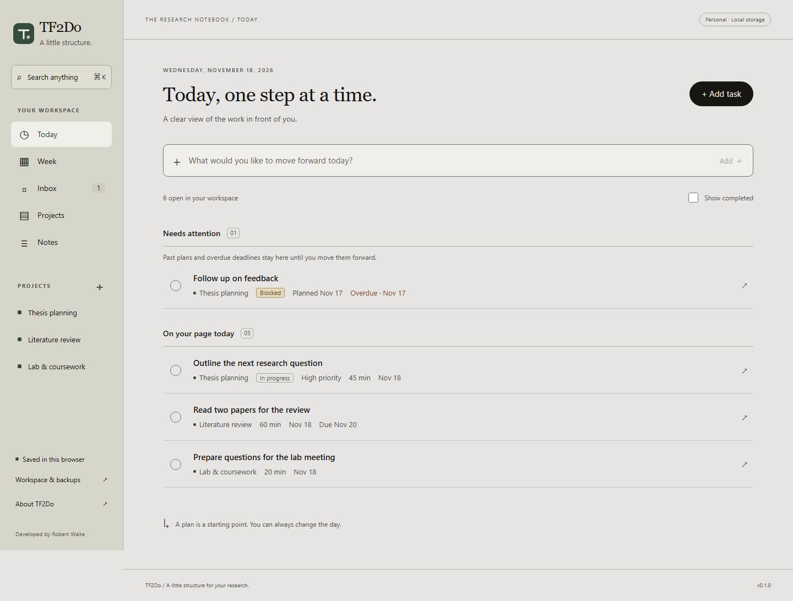

# TF2Do

TF2Do is a personal planner for biotechnology research. Capture tasks as they come up, decide when to work on them, and keep short notes beside the projects they belong to. The name combines **TFII**, a nod to transcription factors, with **to-do**.



- **Today** brings together planned work, overdue deadlines, and tasks that need attention.
- **Week** shows a Monday–Sunday schedule. Open any task to choose its planned day.
- **Inbox** holds tasks that have yet to be scheduled, even if they already have a due date.
- **Projects and Notes** keep related tasks and plain-text notes together. Archived projects retain their records and remain searchable.

## Run locally

Install [Node.js 24](https://nodejs.org/) and [pnpm 11.25.0](https://pnpm.io/installation). Then run these commands from the project directory.

```sh
pnpm install --frozen-lockfile
pnpm dev
```

Open [TF2Do on localhost](http://127.0.0.1:5173/). Start with an empty workspace or choose **Load demo workspace** to explore fictional tasks. TF2Do saves to this browser profile and address. Use **Workspace & backups → Export workspace** before switching browsers or clearing site data.

## Documentation

- [How to use TF2Do](wiki/How-to-Use.md)
- [Backups and recovery](wiki/Backups-and-Recovery.md)
- [Wiki home](wiki/Home.md)
- [Architecture and data model](wiki/Architecture.md)
- [Roadmap](wiki/Roadmap.md)
- [Acknowledgements](ACKNOWLEDGEMENTS.md)

## About the developer

**Robert Waite** is the sole developer of TF2Do and a biotechnology graduate student at the University of South Florida. He built TF2Do around a practical question from research and coursework. How do you keep track of the next step when several projects are moving at once? [Robert on GitHub](https://github.com/fishhrbio)

## Project status

Version 0.1.0 is an individual, browser-based workspace. Accounts, sync across devices, and collaboration are planned work. For build and test commands, see [Development](docs/DEVELOPMENT.md). For rights and dependency notices, see [Copyright](COPYRIGHT.md) and [Third-party notices](THIRD_PARTY_NOTICES.md).
