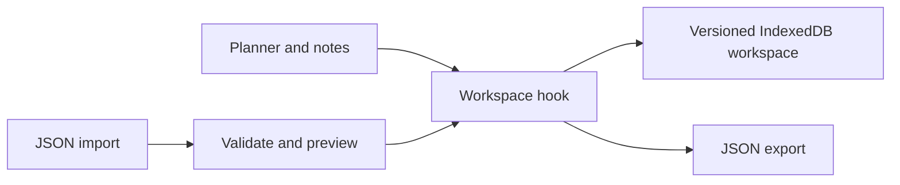

# Architecture

TF2Do is a React and TypeScript app built with Vite. It has no application server. The browser UI calls a workspace hook that serializes saves through an IndexedDB repository.

| Record  | Fields                                                                                                            |
| ------- | ----------------------------------------------------------------------------------------------------------------- |
| Project | ID, name, description, archive timestamp                                                                          |
| Task    | ID, title, description, optional project, status, priority, planned day, due date, estimate, completion timestamp |
| Note    | ID, title, text, optional project and task links                                                                  |

Every record carries creation and update timestamps. Planned days and due dates are local calendar dates stored as `YYYY-MM-DD`. Timestamps use UTC ISO 8601. An unfinished task with a deadline earlier than the local day is overdue. An unfinished task planned earlier than the local day stays discoverable for rescheduling. Completion sets a timestamp and reopening clears it.

## Persistence and export

- The repository stores the workspace and a revision together. A stale tab cannot overwrite a newer revision. Replacing the workspace and saving the preceding recovery copy happen in a single transaction.
- The export object contains `schemaVersion`, `exportedAt`, `projects`, `tasks`, and `notes`. Version 1 validation checks dates, enum values, record IDs, links, and completion state. A valid import preserves IDs and links.
- The workspace lives under the browser profile and origin that created it. TF2Do has no account system or cloud synchronization.

[Back to the wiki home](Home.md)
